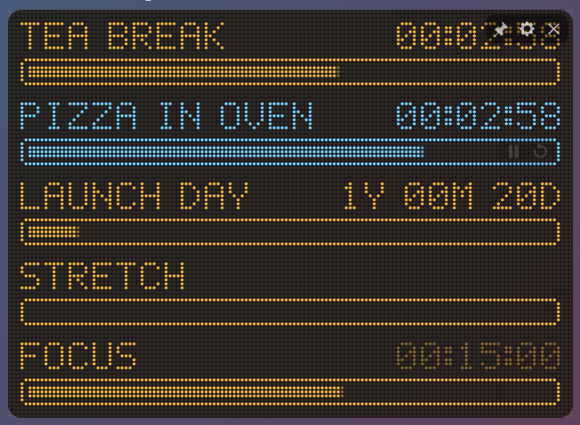
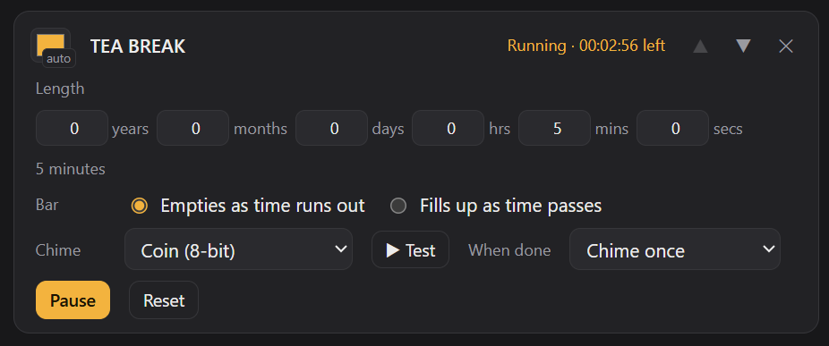

# Dot Timer

A lightweight countdown timer for Windows and macOS. It sits on your desktop as a small dot-matrix display, one timer per block. Each timer shows a label, the time left and a loading bar.

<!-- Add a screenshot as docs/images/widget.png and uncomment:  -->

## What it does

- **Any length.** Set years, months, days, hours, minutes and seconds, in any combination.
- **Several timers.** Stack up to 16. Each has its own label, length, bar direction, colour and chime.
- **A loading bar.** Choose whether the bar **empties** as time runs out or **fills up** as time passes.
- **Time left at a glance.**
  - Under a day it shows `04:05:06`.
  - Over a day it shows `3D 04:05:06`.
  - Over a month it shows `2M 03D 04H`.
  - Over a year it shows `1Y 02M 03D`.
- **Ten chiptune chimes.** They're 8-bit and 16-bit style, split into three high tones, four dual tones and three low tones. All use major keys, so they sound bright and cheerful.
- **Your choice of ending.** Each timer can chime once, or repeat until you click the widget.
- **Fits with World Time.** It automatically matches World Time's width, dot size and colours, so the two sit side by side or stacked like one display. The size never changes as a timer counts down.
- **Stays out of the way.** The widget has no window frame. Drag it anywhere, keep it on top, and it remembers where you left it. Timers keep running while the app is closed.

## Using it

| Action | How |
|---|---|
| Start, pause or reset a timer | Hover over it and use ▶/⏸ and ↺ on the right of its bar |
| Silence a chime | Click anywhere on the widget |
| Add, edit or delete timers | Right-click the widget, or hover and click ⚙ |
| Move it | Drag the widget |

## How it works

- **Small download.** Like World Time, it's built with [Tauri](https://tauri.app): a small Rust program around the web view already on your system. That keeps the installer to a few megabytes.
- **The display** is drawn dot by dot, using the same 5×7 font and layout rules as World Time.
- **Lengths follow the calendar.** "1 month" from 31 January ends on the last day of February, and "1 day" stays at the same clock time across daylight-saving changes.
- **The chimes are synthesised live,** so there are no sound files.
  - 8-bit chimes use pulse waves with stepped, NES-style volume.
  - 16-bit chimes add vibrato, a soft filter and an echo.
- **Matching World Time** works by reading World Time's settings file on your computer.
- **No internet needed.** Settings are saved to a small file on your computer.

## Building it yourself

See [BUILDING.md](BUILDING.md) for how to make the Windows `.msi` and macOS `.dmg` installers.

<!-- Add a screenshot as docs/images/widget.png and uncomment:  -->